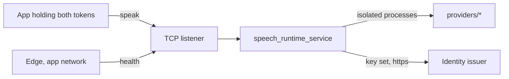

# Architecture

Audience: a developer or reviewer who needs the shape of the speech service and
what it trusts.

## Purpose

One process keeps a German voice resident on the home server and serves it to
Presentator and to apps that speak for a person.
[`README.md`](../README.md) holds the contract and the settings,
[`wire.md`](wire.md) the speech wire.

## Context

## Building blocks

- `src/speech_runtime_service`: the one process, its TCP listener and the
  routes. `callers.py` decides who may speak; `wire_route.py` serves the wire.
- `packages/client`: the wire types an app and the service share.
- `providers/*`: the voices that run in their own processes and environments.

## Crosscutting Concepts

### Trust

- Keycloak is the root. A registered app with valid tokens is trusted within
  its config; one app can only slow another, bounded by the busy wait and the
  input limit. Nothing is kept.
- Every capability passes the caller check. Only `GET /health` and the wire's
  refusals that carry no capability (404 `not_found`, 400 `unsupported_version`)
  answer before it; nothing else is mounted.
- `/health` is reachable only inside edge's app network: the code default binds
  `127.0.0.1`, and the deployment sets `SPEECH_HOST` so the listener sits on
  that network only.
- One instance serves one address and one device; the platform starts one per
  card, and the service keeps no lock per card.
- The speak route admits only a person call. Both tokens are verified by
  webauth against the issuer's key set (signature, issuer, audience, lifetime);
  the workload token must carry the realm role, come from a registered app's
  client and live at most 300 seconds; the person's token must come from the
  same client, name another subject, belong to the app's group or a group below
  it and belong exactly to the configured service group. A call an app makes as itself is refused.
- Which issuer, group and apps count is configuration
  (`SPEECH_CONFIG_FILE`); each app may name only the voices its table lists.
- No token, subject or key-set address reaches a log, an error or a repr.
- A refusal never says which token or claim failed beyond its code.

Residues:

- A copied token works until its `exp` plus the configured leeway; tokens carry
  no sender constraint.
- The issuer's `account` audience stays in a token's `aud` (webauth#516,
  invariant 3).
- `/health` carries no token; the network boundary is its only guard.
