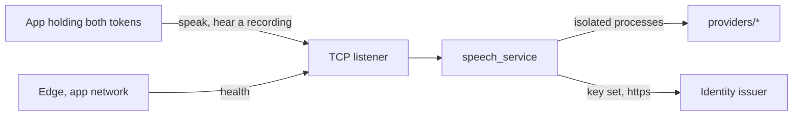

# Architecture

Audience: a developer or reviewer who needs the shape of the speech service and
what it trusts.

## Purpose

One process keeps each offered Piper voice, and optionally a hearing model,
resident on the home server, loads each GPU voice the operator offers on its
first request (or at start, as the GPU image does), and serves them to Presentator and to apps that speak or have a
recording heard for a person. [`README.md`](../README.md) starts it,
[`wire.md`](wire.md) holds the wire and its settings.

## Context

## Building blocks

- `src/speech_service`: the one process, its TCP listener and the
  routes. `voice_slot.py` holds one voice's engine lifecycle and its admission
  gate; `callers.py` decides who may call; `wire_route.py`
  serves the wire; `hearing.py` holds the hearing engine behind a port, the
  language identifier behind its own port, the engine's gate and its one
  submission worker; `live_session.py` is a live session's state machine;
  `hearing_session.py` schedules its turns and partials from a speech detector;
  `voice_activity.py` holds the streaming Silero VAD and the turn thresholds;
  `pcm.py` the resampler; `hearing_models.py` the pinned models
  and each one's voiced floor; `recording.py` the incremental decode of an
  uploaded recording; `clock.py` the monotonic clock every gate deadline is read
  and waited on.
- `Dockerfile`, `compose.yaml`, `deploy/speech.toml`: the containers the dated
  tag brings: the small image with the Piper voices, the `small` hearing model and the
  caller table baked in, and the `gpu` target, which adds Qwen, its server environment
  and large-v3; the release builds, attests and pushes both to GHCR, see
  [Delivery](#delivery). `scripts/prove_image.py` proves the small one.
- `packages/client`: the wire types an app and the service share (the closed voice catalogue among them), the bounded speaking call, the bounded health fetch, the live hearing session (`HearingSession`: the allowed languages, frames held up to a caller-set byte limit, typed server events that name each item's language, one closed outcome union), the relay (`relay`) of a browser socket to that session an app makes, and `hear_utterances`, which builds that session and hands an app finished utterances.
- `packages/browser`: the framework-free browser package (`overnightworks-speech-browser`) an app's page streams its microphone and plays sounds with. `startCapture` takes the first audio track of the app's own stream, resamples it with a filter to the wire's PCM16 at 24 kHz in its own same-origin AudioWorklet file and main-thread resampler, and sends 100 ms frames to the app's relay route, capturing only once the hop socket is open, so it sends no audio older than the app's accept of that socket; it has no loudness gate, hands the app every message the app's own server sends down the hop (its optional `onMessage`, uninterpreted, in arrival order, until the capture ends), and its `ended` names how the hop ended. `createPlayer` plays the sounds an app hands it, each as bytes or the URL of the app's own route, in the order of the calls (a route answering 16-bit mono PCM WAV plays while its body still arrives, its chunks scheduled back to back; every other sound plays whole), as sources into the player's one GainNode, the only input of the output (the one node a per-frame reader can tap; the package builds none). It reports each sound's start and end once; the start carries the context time at which the sound's first sample plays and the context it plays on (none for a sound that ended first), and the end says how it ended (played, stopped, muted, refused (no user activation, or `resume()` refused), or failed to load); `stop` and `setMuted(true)` end the playing and every waiting sound at once and abort their fetches, and `close` also closes the context. The ends of played, stopped and muted sounds carry `playedSeconds`, read from the context's clock. Both are exported from one entry, `index.ts`. Its `hop.ts` is generated from `PcmFormat` and `speech_client.relay` by `scripts/generate_browser_wire.py`.
- `providers/*`: the voices that run in their own processes and environments. Each is its own uv project with its own lock; `providers/provider-contract` is the shared source the others install from. The client in `packages/client` is a uv workspace member of the root.

### Speaking

- **The offer.** `speech_client.wire` owns the closed catalogue: each voice's
  model, name and languages. `voices.py` owns what the service adds: every
  Piper voice loads at start, every other voice is a GPU voice. `Runtime.from_settings`
  composes the offer, one slot per voice `SPEECH_VOICES` names, in catalogue
  order. The offer decides which voice may take the card.
- **Piper at start, a GPU voice on its first request.** The start loads each
  offered Piper voice in order, then hearing; a failed Piper load ends the
  process. With `SPEECH_LOAD_GPU_VOICES_AT_START` each GPU voice loads at start too,
  after the Piper voices and before hearing, and `/health` is ready only
  after it. Otherwise a GPU slot stays idle,
  with no process and no CUDA context, until a request names it. Its first
  request starts the slot's one load job on a thread the slot owns, and every
  request for that voice awaits the same job. Nothing unloads a voice.
- **Qwen speaks through its own server.** Its worker starts `vllm-omni serve`
  as a child in `load`, on the pinned checkpoint, and `load` returns once the
  child answers its health check. A request goes to it over HTTP on a Unix
  socket and its audio is read per arrived chunk, so the first chunk reaches the
  caller before the second is made; the instructions cross as the request's
  `instructions`. The server reserves 0.45 of the card (0.3 for the talker, 0.15
  for the decoder) and assumes nothing about being alone on it.
- **Three load rules.** A request that leaves never cancels a shared load: the
  job's future runs before its thread starts and requests await it shielded. A
  load first checks the voice's pinned files and worker, and a failed load
  closes and reaps what it built, and any worker a crash left, before it
  resolves, so a retry starts only once no worker of that voice remains. An
  engine is closed only off the event loop: on the job's thread, the start and
  stop threads, or Starlette's threadpool.
- **Failure isolation.** A failed load, missing files or a crashed worker make
  that voice refuse 503 `unavailable` with `param` `voice` and report itself
  not ready, while the Piper voices and hearing keep serving; the next request loads it
  again. A worker that cannot be reaped ends the process.
- **One readiness.** `/health` and the refusal read the same answer, so no voice
  is ready during the start load or once the drain began, and `speaking.ready`
  is every offered Piper voice's. A request that held its voice's gate across a stop or a crash is
  refused `unavailable`, never `busy`.
- **One gate per voice.** Each voice's slot owns an `AdmissionGate` with the
  speaking limits, so a long GPU synthesis never makes a Piper voice `busy`.

### Hearing

- **One engine, local files only.** faster-whisper runs in the process, its
  inference in a worker thread off the event loop. It loads at start from the
  pinned snapshot in the Hugging Face cache (`local_files_only`) on
  `SPEECH_DEVICE`; the command `speech-fetch-hearing-model` is the only
  thing that downloads a hearing model. The compute type follows the device. Decoding is
  deterministic (greedy, temperature 0).
- **The language choice is its own step.** For a session set of two or more
  languages, a `LanguageIdentifier` behind a fixed port inside `hearing.py` names
  a language of the set or says it does not know, and then the set's first
  language holds. The recogniser encodes the first window once and lends the
  identifier its language scores and the PCM, so the choice costs one decoder
  step; the shipped `ScoreIdentifier` does not know below the model's voiced
  seconds (`hearing_models.py`). The session, the wire and the decode never see
  which identifier runs.
- **Turns start and end on Silero VAD.** The Silero model that ships with
  faster-whisper runs in the process on the CPU: one ONNX session, loaded and
  shape-checked with the Whisper model (a failure stops the start), and one
  stream per live session that carries its state, so loudness plays no part and a
  noise opens no turn. `HearingSession` stays pure behind a `SpeechDetector`
  port; the start and end thresholds, the start confirmation and the pre-roll are
  constants of `voice_activity.py`. A turn decodes from a pre-roll before its
  speech, and a voiced second is one speech window; the language identifier's
  floor counts voiced seconds. Hearing applies the recogniser's no-speech rule
  itself (a high no-speech probability together with a low average log
  probability): a decode that meets it adds no words, and every decode reports its two
  measures all the same. The log line of each finished live turn holds the
  duration, voiced seconds, no-speech probability and average log probability of
  its decode, skipped or not (a partial decode logs its two measures on a line of
  its own), and never its text. Hearing drops nothing that Silero calls a voice,
  with one exception: a turn Silero opened whose decode meets the no-speech rule
  ends with no words, and no new confidence gate is added; a gate on the measures
  waits for a recorded corpus. The recording route has no turns and decodes the whole file under the
  same rule.
- **The relay.** `speech_client.relay` (in `packages/client`) is what an app
  mounts behind its own login check: it forwards a browser's binary audio
  frames to a hearing session and hands the typed events to the app, never to
  the browser. The tokens stay on the app's server.
  `speech_client.utterances` builds on it: `hear_utterances` builds the session
  and maps the events to finished utterances, optional partials and a service
  failure, so an app keeps its route, its login check, its token choice, its rule
  and when a hearing ends.
- **Load isolation.** A load that fails for want of the resource (no CUDA
  device, a card too full) frees what it allocated and leaves the process up:
  `/health` names hearing not ready, the route answers 503 `unavailable`, and
  speaking is untouched. A misconfiguration (a model that was not fetched, an
  unknown model, a malformed setting) stops the start naming the setting.
- **Two admission resources.** Speaking and hearing are separate scarce
  resources, one job at a time each. Each has an `AdmissionGate` with its own
  waiting places and wait, so a busy synthesis never refuses a recording nor a
  busy decode a speak request. A gate lease is given back only when the native
  call has returned: CTranslate2 cannot be interrupted, so a caller that left
  does not free the decode.
- **One submission owner.** `Hearing` owns a one-worker executor for file and
  live decodes. A decode carries its lease: the worker closes it when the native
  call returns, the done-callback when the decode was cancelled before it
  started, the submitter when the submission fails. `Hearing` admits no new
  session or recording from the drain on, and keeps taking submissions of those
  admitted; at the close it takes no new submission and frees the engine after
  the running decode returns.
- **The live session.** `/v1/realtime` is one state machine per socket. Receiving
  never waits for a decode: audio is resampled from 24 to 16 kHz and scheduled
  into turns (Silero speech, then silence, or the 30 s cap), and decodes run in the
  worker. One lock orders messages, polls and results, and the session alone
  decides each item's terminal event, once; a result that arrives after its item's
  terminal is dropped. A session holds two ended turns and the open turn. Both
  ended turns queue as finals in the gate from their turn's end, ahead of
  recordings, each with a deadline counted from it, and an expired final is never
  started; the second's terminal waits for the first's.
  A session end sends a `failed` per announced unfinished item, then `error`, then
  closes; a disconnect sends nothing. In a drain the session's poll ends it at a
  turn boundary: it takes audio until the open turn ends (by itself, or cut 30 s
  after the drain began), lets the queued finals complete, then closes `1012` with
  no `error`.

## Delivery

The release builds, attests and pushes two images to GHCR, the gpu one at the dated
tag with `-gpu` first, then the small one at the dated tag. hal builds its own small
image from the dated tag, so the tag fixes the code, locked dependencies, voices,
hearing model and caller table. Nothing is fetched at start or restart: the
voices and the hearing model are in the image, each fetched by a shipped
command at its pinned revision, and the service has no route to a registry or a
hub. The small image carries no GPU voice and hears with `small` on the CPU. The
healthcheck requires Piper and hearing
to be ready, so a deployment that cannot hear is not recorded. Qwen is offered
only when the start setting names it, and then launches on `cuda`, the provider
contract's one device for it, whatever device hearing uses. Offered on the
small image, which lacks its environment and weights, it is not installed: its
requests are refused `unavailable`, `/health` reports it not ready, and the
Piper voices and hearing keep serving.

The gpu image is the same service with the six voices, Qwen's pinned weights,
large-v3 and the Qwen provider's own environment: uv-managed CPython 3.12, which
vLLM-Omni caps below the service's 3.14, pinned through the uv image's digest,
beside the service's CUDA 12 libraries for CTranslate2, and a C compiler with
the C library headers, which Triton needs to build its run-time modules (it takes
the Python headers from that interpreter). It sets Qwen to load at
start and hearing to large-v3 on `cuda`, so `/health` is ready only once both
are loaded. The environment is too large for a standard runner's disk, so its
release job builds on the larger runner `speech-gpu-build`, and each layer stays
under 10 GB. Which workload holds the card is the platform's switch.

The service sits on external, internal networks and no default one: one
shared with the gateway that carries the key set, and one per app that reaches it
on hal's Compose path, shared with that app only. An absent network stops the
start, so a run never has egress. The root is read-only, the user is not root and
no capability is kept.

The service owns the stop signal: uvicorn's own signal handling is off. On
SIGTERM or SIGINT the shutdown runs in one order. The runtime reports not ready
and refuses new work (the drain begins); the live sessions end at their turn
boundaries; the server then shuts down, waiting for the speak streams and
recordings still running; the engines close last. A speak stream or a final is
never cut by an engine closing under it. The drain is bounded by one number,
30 s (the open turn) plus `SPEECH_HEARING_FINAL_WAIT_SECONDS` (default 60 s), so
90 s by default; past it the server's shutdown cuts what still runs, the engines
close and the process exits 0. A pod's grace period must be at least the drain
bound plus the time its endpoint takes to leave the balancer (a preStop sleep),
and a replacement must start before the old pod stops (a rolling update that
never lowers the ready count).

## Crosscutting Concepts

### Trust

- Keycloak is the root. A registered app with valid tokens is trusted within
  its config; one app can only slow another, bounded by the busy wait and the
  input limit. Nothing is kept.
- Every capability passes the caller check. Only `GET /health` and the wire's
  refusals that carry no capability (404 `not_found`, 400 `unsupported_version`)
  answer before it; nothing else is mounted.
- `/health` is reachable only inside edge's app network: the code default binds
  `127.0.0.1`, and the deployment sets `SPEECH_HOST` so the listener sits on
  that network only.
- One instance serves one address and one device; the platform starts one per
  card, and the service keeps no lock per card.
- The speak route admits only a person call. Both tokens are verified by
  webauth against the issuer's key set (signature, issuer, audience, lifetime);
  the workload token must carry the realm role and come from a registered app's
  client; the person's token must come from the
  same client, name another subject, belong to the app's group or a group below
  it and belong exactly to the configured service group. A call an app makes as itself is refused.
- Which issuer, group and apps count is configuration
  (`SPEECH_CONFIG_FILE`).
- No token, subject or key-set address reaches a log, an error or a repr, and
  no spoken or heard text reaches a log. Each live turn logs its timings, and
  nothing it heard.
- A provider's failed synthesis reaches the service log only as its types,
  errno names or numbers, int error codes and exit statuses, and code frames,
  escaped and at most 4 KB in its FAILED frame, and the provider's stderr
  after READY stays /dev/null.
- Qwen's server is the worker's child, reachable only through a Unix socket in
  the worker's private directory, a fresh path per start, so no port opens and a
  server left by an earlier start is never mistaken for the new one. Readiness
  counts only while that child lives. It sends no telemetry
  (`VLLM_NO_USAGE_STATS`, `DO_NOT_TRACK`), compiles nothing with `nvcc`, which
  the image does not carry (its FlashInfer sampler is off through
  `VLLM_USE_FLASHINFER_SAMPLER`, vLLM's other FlashInfer kernels are off while
  no `nvcc` is found, and attention takes FlashAttention below compute
  capability 10; only Triton and Inductor compile, with the image's `gcc`), its
  stdout goes nowhere, and its
  stderr joins the worker's own, which is the startup file until READY and
  `/dev/null` after.
- The server dies with its worker (the parent-death signal, set on the worker's
  main thread) and stays in the worker's process group, so the service's stop
  ends every stage process through that group, also after the worker died first.
  The worker ends when its server does, so health never reports a voice whose
  server is gone. The next start removes the wake directories a killed server
  left in `/dev/shm`, those its user owns and no process still reads; a link
  there is never followed.
- vLLM-Omni's deploy config and its tokenizer load still ask for
  `trust_remote_code`; the command no longer does. The pinned snapshot holds no
  Python file and no `auto_map`, and the process runs offline, so there is no
  remote code to fetch or run.
- A refusal never says which token or claim failed beyond its code.
- The browser hop of the client's relay is the app's: its frames are untrusted
  and bounded (a text frame or a frame over the app's limit ends it with a named
  close code), admission is the app's, and the tokens stay on the app's server,
  so the browser sees no token, and the relay forwards it no event. What the
  app's route writes on its own browser socket is the app's.
- The browser package receives no token and interprets no message of the hop;
  it hands the messages the app's server wrote there to the app's `onMessage`
  as they came. It opens no device: the app turns the microphone on in its own
  `Permissions-Policy` (webauth's default turns it off), owns the stream and the
  switch, and serves the worklet from its own origin, which webauth's
  `script-src 'self'` admits.
- The browser package's player fetches only the URL the app hands it, with the
  browser's default same-origin credentials and no added header, which
  webauth's `connect-src 'self'` admits, and holds no token. It plays through
  Web Audio and keeps nothing on the device.

## Constraints and reasons

- **The operator owns the card.** The service knows nothing of another GPU user
  and arbitrates nothing. `SPEECH_VOICES` is his switch, the Piper voices alone by
  default, and a loaded GPU voice keeps the card until the process ends; the
  platform decides which workload runs on it.
- **The service never downloads.** Shipped commands fetch voices and hearing
  models at a pinned revision, so the dated tag fixes what runs and the
  container needs no egress.
- **A replica holds connections only.** A live hearing session lives on the one
  process that serves its socket, and that process drains it on a stop (see
  [Delivery](#delivery)); a client that was closed `1012` opens a new session on
  any replica. Nothing a session holds outlives it, so replicas share no store
  and need no sticky routing: readiness (`/health`) alone steers new
  connections.
- **Piper is resident and on the CPU.** Each offered Piper voice loads at start
  and stays resident. A taken card never silences speaking, and a failed Piper
  load ends the process. With hearing on `cpu`, as the image runs it, speaking
  and hearing share the CPU.

## Not chosen

- **Kokoro-German:** the official Kokoro has no documented German and the
  community fine-tune warns it is undertrained; reopens when German is trained.
- **XTTS-v2 and its forks:** the Coqui Public Model License excludes commercial
  use; reopens if the weights get a permissive licence.
- **Orpheus (`Thorsten-Voice/tv-orpheus-v1`):** a 3B talker of about 8 GB, its
  first audio never measured here; reopens when it is measured inside the
  one-second first-audio target.
- **Chatterbox, Magpie and VoxCPM:** each GPU voice costs its own environment,
  weights and card proof; reopens when the operator names a voice he wants.
- **Piper `thorsten-high`:** its first audio through the service was over the
  one-second target when measured; reopens if the target moves.
- **Freeing a GPU voice or arbitrating the card in the service:** the operator
  turns a voice off in the setting; reopens when he forgets that often, with a
  second card or with a platform-level reservation.

## Risks

- The platform moves to k3s and Flux, which replace Compose and hal. Until the
  switch `compose.yaml` runs the service, naming no GPU voice and reserving no
  card: it speaks with Piper and hears on the CPU. The card reservation and its
  proof wait for the platform's GPU design.
- A GPU voice is proven with a fake worker and a fake server. CI builds and
  proves the small image only; the gpu image is first built by the release, so a
  lock change that breaks its environment shows there, and its speaking and
  hearing on the card are proven by a GPU run of the built image.
- Qwen's first audio can take longer than `SPEECH_BUSY_WAIT_SECONDS`, so a
  second request for it may answer `busy` while one long sentence runs. Without
  the start setting the first request also waits for the server to load, about
  five minutes.
- Speaking and hearing share the CPU when hearing runs on `cpu`, as the image
  does. `scripts/prove_speech.py` measured this on a shared development machine,
  on the CPU with the `small` hearing model and four of the Piper voices (all
  but Kerstin), in two runs. Speaking times are medians of five repetitions. A single Piper voice's
  first audio took 0.21 to 0.24 s; two voices speaking at once took 0.33 to
  0.45 s each to first audio; a recording heard alone took about 1.5 s, and 4.1
  to 5.4 s while two voices speak without pause; the service's peak resident
  memory was 1.7 to 1.9 GB. These are ranges on that machine, not promises.
- The service imports `piper-tts`, which is `GPL-3.0-or-later`, in a repository
  licensed MIT; the obligation that follows is not settled here.
- A copied token works until its `exp`, with no leeway; tokens carry no sender
  constraint, and the issuer's `account` audience stays in a token's `aud`.
  A live hearing session opened before `exp` runs until it ends: the app closes it
  (the client's hearing session also at its total deadline) or a failure ends it. The
  service does not end it when a token expires or the person loses the right, so the
  app ends a hearing when its right to hear ends.
