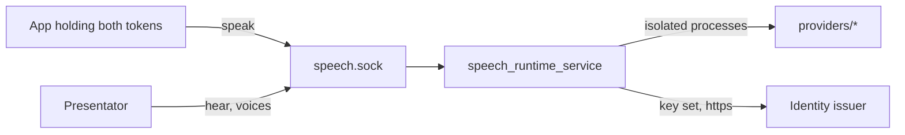

# Architecture

Audience: a developer or reviewer who needs the shape of the speech service and
what it trusts.

## Purpose

One process keeps a German voice and a German listener resident on the home
server and serves them to Presentator and to apps that speak for a person.
[`README.md`](../README.md) holds the contract and the settings,
[`wire.md`](wire.md) the speech wire.

## Context

## Building blocks

- `src/speech_runtime_service`: the one process, the private socket and the
  routes. `callers.py` decides who may speak; `wire_route.py` serves the wire.
- `packages/client`: the wire types an app and the service share.
- `providers/*`: the voices that run in their own processes and environments.

## Crosscutting Concepts

### Trust

- The socket is private: its directory and socket belong to one UID, and the
  process binds no TCP port.
- The speak route admits only a person call. Both tokens are verified by
  webauth against the issuer's key set (signature, issuer, audience, lifetime);
  the workload token must carry the realm role, come from a registered app's
  client and live at most 300 seconds; the person's token must come from the
  same client, name another subject and belong to the app's group and exactly
  to the configured service group. A call an app makes as itself is refused.
- Which issuer, group and apps count is configuration
  (`SPEECH_CONFIG_FILE`); capabilities per app are not yet checked.
- No token, subject or key-set address reaches a log, an error or a repr.
- A refusal never says which token or claim failed beyond its code.

Residues:

- A copied token works until its `exp` plus the configured leeway; tokens carry
  no sender constraint.
- The issuer's `account` audience stays in a token's `aud` (webauth#516,
  invariant 3).
- `/hear` and `/voices*` are guarded only by the socket's UID.
