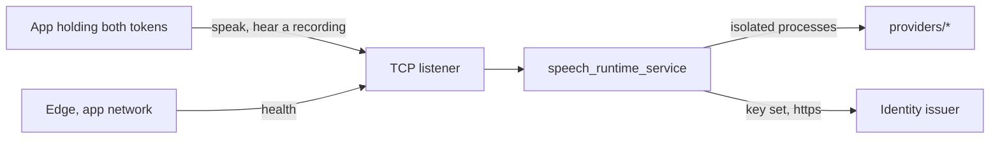

# Architecture

Audience: a developer or reviewer who needs the shape of the speech service and
what it trusts.

## Purpose

One process keeps a German voice, and optionally a hearing model, resident on
the home server and serves them to Presentator and to apps that speak or have a
recording heard for a person.
[`README.md`](../README.md) holds the contract and the settings,
[`wire.md`](wire.md) the speech and transcription wire.

## Context

## Building blocks

- `src/speech_runtime_service`: the one process, its TCP listener and the
  routes. `callers.py` decides who may speak and who may hear; `wire_route.py`
  serves the wire; `hearing.py` holds the hearing engine behind a port, its
  gate and its one submission worker; `live_session.py` is a live session's
  state machine; `hearing_session.py` schedules its turns and partials; `pcm.py`
  holds the resampler; `hearing_models.py` the pinned models; `recording.py` the
  incremental decode of an uploaded recording; `clock.py` the monotonic clock
  every gate deadline is read and waited on.
- `packages/client`: the wire types an app and the service share.
- `providers/*`: the voices that run in their own processes and environments.

### Hearing

- **One engine, local files only.** faster-whisper runs in the process, its
  inference in a worker thread off the event loop. It loads at start from the
  pinned snapshot in the Hugging Face cache (`local_files_only`) on
  `SPEECH_DEVICE`; the command `speech-runtime-fetch-hearing-model` is the only
  thing that downloads. The compute type follows the device. Decoding is
  deterministic (greedy, temperature 0).
- **Load isolation.** A load that fails for want of the resource (no CUDA
  device, a card too full) frees what it allocated and leaves the process up:
  `/health` names hearing not ready, the route answers 503 `unavailable`, and
  speaking is untouched. A misconfiguration (a model that was not fetched, an
  unknown model, a malformed setting) stops the start naming the setting.
- **Two admission resources.** Speaking and hearing are separate scarce
  resources, one job at a time each. Each has an `AdmissionGate` with its own
  waiting places and wait, so a busy synthesis never refuses a recording nor a
  busy decode a speak request. A gate lease is given back only when the native
  call has returned: CTranslate2 cannot be interrupted, so a caller that left
  does not free the decode.
- **One submission owner.** `Hearing` owns a one-worker executor for file and
  live decodes. A decode is submitted with its lease: the worker closes the lease
  when the native call returns, the future's done-callback when it was cancelled
  before it started, and the submitter when the submission fails. At shutdown
  `Hearing` takes no new submission and frees the engine after the running decode
  returns.
- **The live session.** `/v1/realtime` is one state machine per socket. Receiving
  never waits for a decode: audio is resampled from 24 to 16 kHz and scheduled
  into turns (C2: silence after speech, or the 30 s cap), and decodes run in the
  worker. One lock orders messages, polls and results, and the session alone
  decides each item's terminal event, once; a result that arrives after its item's
  terminal is dropped. A session holds one outstanding final, one waiting ended
  turn and the open turn. Finals queue in the gate ahead of recordings with a
  deadline counted from the turn's end, and an expired final is never started.
  A session end sends a `failed` per announced unfinished item, then `error`, then
  closes; a disconnect sends nothing.

## Crosscutting Concepts

### Trust

- Keycloak is the root. A registered app with valid tokens is trusted within
  its config; one app can only slow another, bounded by the busy wait and the
  input limit. Nothing is kept.
- Every capability passes the caller check, and hearing also the app's `hear`
  permission in the configuration (off unless listed). Only `GET /health` and the wire's
  refusals that carry no capability (404 `not_found`, 400 `unsupported_version`)
  answer before it; nothing else is mounted.
- `/health` is reachable only inside edge's app network: the code default binds
  `127.0.0.1`, and the deployment sets `SPEECH_HOST` so the listener sits on
  that network only.
- One instance serves one address and one device; the platform starts one per
  card, and the service keeps no lock per card.
- The speak route admits only a person call. Both tokens are verified by
  webauth against the issuer's key set (signature, issuer, audience, lifetime);
  the workload token must carry the realm role, come from a registered app's
  client and live at most 300 seconds; the person's token must come from the
  same client, name another subject, belong to the app's group or a group below
  it and belong exactly to the configured service group. A call an app makes as itself is refused.
- Which issuer, group and apps count is configuration
  (`SPEECH_CONFIG_FILE`); each app may name only the voices its table lists
  and hears only if its table says so.
- No token, subject or key-set address reaches a log, an error or a repr, and
  no spoken or heard text reaches a log.
- A refusal never says which token or claim failed beyond its code.

Residues:

- A copied token works until its `exp` plus the configured leeway; tokens carry
  no sender constraint.
- The issuer's `account` audience stays in a token's `aud` (webauth#516,
  invariant 3).
- `/health` carries no token; the network boundary is its only guard.
